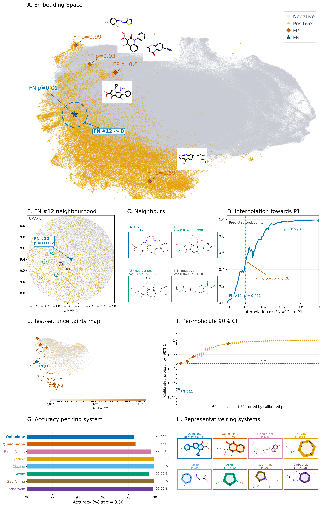
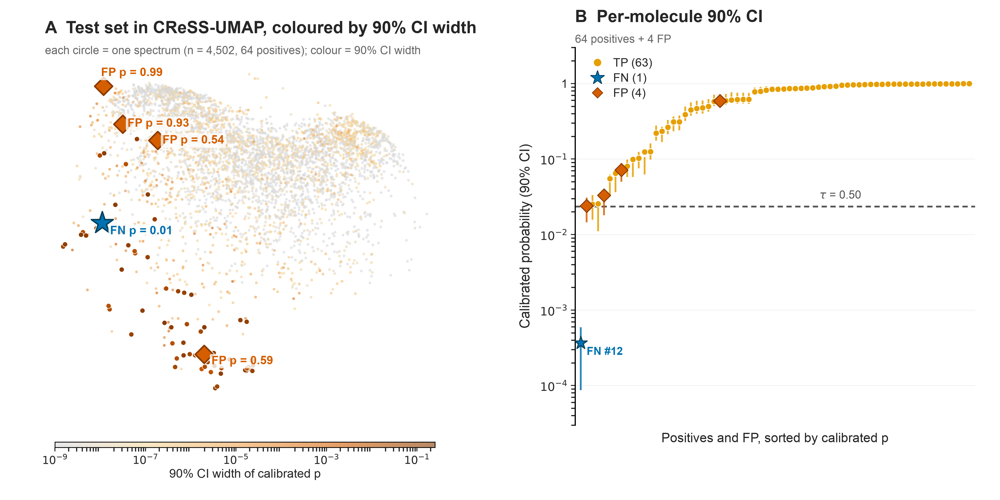
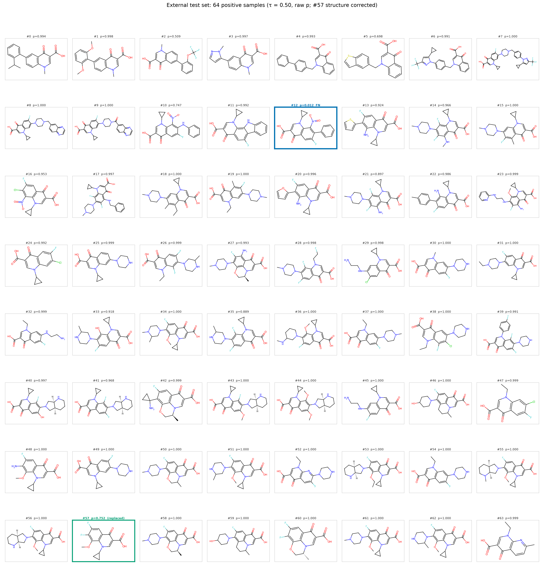

# NMR Core Molecule Detection — CMGNet-SPrompt

Detection of the **quinolone core scaffold** from pure ¹³C NMR peak lists, combining
conditional molecular generation (CMGNet) with a CReSS/XGBoost gate.

The target pharmacophore is the 4-oxo-1,4-dihydroquinoline-3-carboxylic-acid core:

```
OC(C1=C([R2])N([R1])C2=[R]([R8])C([R7])=C([R6])C([R5])=C2C1=O)=O     R = C or N
```

Chromone/coumarin analogues are treated as negatives; the aza (R = N) variant is a positive.

---

## Headline results

External test set: **4,502 spectra / 64 positives** (cross-dataset, zero overlap with training),
operating threshold **τ = 0.50** on the raw score.

| TP | FP | FN | TN | Precision | Recall | F1 |
|---:|---:|---:|---:|---:|---:|---:|
| 63 | 4 | 1 | 4,434 | 0.940 | 0.984 | **0.9618** |

**Top-10 core-hit rate** on the 64 positives (a hit = at least one of the top-10 generated
candidates contains the quinolone core; mean ± s.d. over seeds 0/2006/42):

| Model | Core hit (top-10) | Hit rate | Exact@10 |
|---|---|---:|---:|
| **CMGNet-SPrompt** (ex1209, 3 runs) | 63.33 ± 0.58 / 64 | **99.0% ± 0.9%** | 18.67 ± 0.58 / 64 (29.2% ± 0.9%) |
| XGBoost-CReSS (classifier) | 63 / 64 | 98.4% | — |
| CMGNet-Frag (ex1209, 3 seeds) | 62.67 ± 0.58 / 64 | 97.9% ± 0.9% | 0 / 64 |
| CMGNet-SMILES (ex1209, 3 seeds) | 62.33 ± 0.58 / 64 | 97.4% ± 0.9% | 19.33 ± 2.31 / 64 (30.2% ± 3.6%) |
| CMGNet 0910 (original) | 52 / 64 | 81.2% | 6 / 64 (9.4%) |
| NMRMind | 48 / 64 | 75.0% | 1 / 64 (1.6%) |
| NMR-Solver | 41 / 64 | 64.1% | 16 / 64 (25.0%) |

**XGBoost-CReSS classifier at τ = 0.50** (external set, 3 seeds where applicable):

| Training corpus | Precision | Recall | F1 |
|---|---:|---:|---:|
| experimental only (`exp_lit`, 66 pos) | 1.000 ± 0.000 | 0.193 ± 0.033 | 0.322 ± 0.046 |
| synthetic + experimental, no PubChem | 0.993 ± 0.013 | 0.688 ± 0.016 | 0.812 ± 0.012 |
| full + ex_train + PubChem 1209 | 0.934 ± 0.000 | 0.891 ± 0.000 | 0.912 ± 0.000 |
| NMRMind training split | 0.974 ± 0.023 | 0.385 ± 0.009 | 0.552 ± 0.012 |



*Figure 2. (A) CReSS embedding of the external test set with 90 % bootstrap credible
intervals; (B–D) calibrated probability landscape; (E–F) per-molecule calibrated
probability and interval; (G–H) ring-system detection accuracy. See
`results/figures/fig_model_analysis_v5_caption.md` for the full caption.*



*Figure S-x. Calibrated probability with 90 % bootstrap interval for every external-test
molecule; the raw-score threshold τ = 0.50 corresponds to 0.0235 on this calibrated scale.*



*Figure S-y. All 64 external positives (raw p at τ = 0.50). FN #12 is highlighted.*

---

## Repository layout

```
.
├── main_cmgnet.py                  # CMGNet training / inference entry point
├── infer.py                        # CReSS ModelInference wrapper (XGBoost head)
├── new_RingSystemFinder.py         # ring-system extraction used by CMGNet
├── train_xgb_cress_new_dataset.py  # XGBoost-CReSS training (multi-seed)
├── summarize_core_smiles.py        # generated candidates -> core-hit / ExactMatch
├── calculate_cmgnet_metrics.py
├── model/                          # CReSS model definition
├── utils/                          # shared helpers
├── data_process/                   # raw-source parsers (nmrshiftdb, BMRB, HMDB, PubChem, ...)
├── scripts/
│   ├── build_lmdb/                 # dataset rebuild utilities (see data/README.md)
│   ├── train/                      # CMGNet-SPrompt + XGBoost training
│   └── infer/                      # CMGNet-SPrompt inference (gate + generation)
├── data/                           # rebuilt LMDB / JSON splits (see data/README.md)
├── checkpoints/
│   ├── train_cmgnet_ring_system_3.2_1029_v2_best.ckpt   # CMGNet-SPrompt weights
│   ├── 1220_last.ckpt
│   ├── bart_base_0910/             # BART backbone
│   └── cress/                      # CReSS encoder + SMILES tokenizer
├── models/xgboost/model_xgb_cress_1220.pkl   # XGBoost core classifier
├── nmr_core_system/                # Django web service (inference UI)
├── docker/my-nmr-service_v1.0-web.tar.gz     # prebuilt service image
├── results/                        # figures + result tables used above
└── reports/                        # figure-generation scripts and captions
```

---

## Data

All corpora are rebuilt into per-category LMDBs. Full provenance and rebuild
commands are in [`data/README.md`](data/README.md).

| Category | Path | Records | Positives |
|---|---|---:|---:|
| Experimental literature | `data/experimental/exp_lit.lmdb` | 49,984 | 55 |
| Extra experimental train (nmrshiftdb) | `data/experimental/ex_train.lmdb` | 24,520 | 11 |
| Synthetic / predicted | `data/synthetic/synth_predicted.lmdb` | 1,488,432 | — |
| PubChem positives | `data/pubchem/pubchem_1209.lmdb` | 77,328 | 77,328 |
| NMRMind train | `data/nmrmind/train.lmdb` | 2,137,771 | 3,288 |
| NMRMind validation | `data/nmrmind/validation.lmdb` | 55,167 | 81 |
| NMRMind test | `data/nmrmind/test.lmdb` | 55,150 | 87 |
| Validation (clean, new_dataset) | `data/validation/validation.lmdb` | 40,667 | 37 |
| External test | `data/external_test/external_test.lmdb` | 4,502 | 64 |
| F-splitting subset | `data/f_split/*.json` | 48 + 48 | 48 |

Notes:

* The original 3.20 M-record `new_db.lmdb` is split by its `source` field:
  experimental (NMR BANK, c13_naproc, bmrb, Spektraris, GlycoNMR, hmdb) vs.
  predicted/synthetic (multi, napacd, acd_lotusv9, pnmrnp2).
* The `NMRium` subset (1.66 M, 51.9 %) is **excluded** from both corpora because its
  provenance could not be verified. It can be re-included by editing the source sets in
  `scripts/build_lmdb/split_newdb_by_source.py`.
* External test #57 was corrected after a source-audit: the original record was the
  3-ethyl ester (`CCOC(=O)...`, 15 peaks); it was replaced by the corresponding
  carboxylic acid (`COc1c(F)c(F)cc2c(=O)c(C(=O)O)cn(C3CC3)c12`, 14 peaks) from the
  65-positive reference table.
* Leakage: external test / validation / test are exact-SMILES and stereo-stripped
  disjoint from the training corpora (0 overlaps). See `data/README.md`.

---

## Environment

```bash
conda create -n nmr python=3.12
pip install -r requirements.txt
# PyTorch with CUDA 12.x, pytorch-lightning, transformers, rdkit, lmdb,
# xgboost, scikit-learn, joblib, matplotlib, pandas
```

Two environments are used in the original work:

* **training** (`py312`): `torch 2.9`, `transformers 5.x`, `pytorch-lightning`
* **inference** (`py312_tf457`): `transformers 4.57.6` (checkpoint compatibility)

Set `PY=...` when calling the scripts below.

---

## Training

### 1. CMGNet-SPrompt (generative core detection)

```bash
bash scripts/train/train_cmgnet_sprompt.sh 42 0
# seed=42, GPU 0; override EPOCHS/BATCH_SIZE/ACCUM via env vars
```

The script fine-tunes `checkpoints/train_cmgnet_ring_system_3.2_1029_v2_best.ckpt` on the
three training corpora (experimental + synthetic + PubChem) with ring-system prompting,
5 epochs, batch 48 × grad-accum 2, lr 1e-4, NMR/SMILES augmentation.

### 2. XGBoost-CReSS classifier

```bash
python train_xgb_cress_new_dataset.py \
    --train_lmdb data/experimental/exp_lit.lmdb \
    --extra_train_lmdb data/pubchem/pubchem_1209.lmdb \
    --extra_train_json data/experimental/ex_train.json \
    --valid_json data/validation/validation.json \
    --test_json  data/validation/validation.json \
    --external_json data/external_test/external_test.json \
    --seeds 42,0,2006 --out_dir output/xgb_cress_sprompt
```

Add `data/synthetic/synth_predicted.lmdb` to the training mix for the full baseline.

---

## Inference

```bash
bash scripts/infer/infer_cmgnet_sprompt.sh \
    data/external_test/external_test.json \
    output/infer_sprompt_external 0
```

Three stages:

1. **Gate** — CReSS embedding → XGBoost probability → 0/1 vote at 0.5
   (`scripts/infer/make_sprompt_votes.py`).
2. **Generation** — `main_cmgnet.py --decode_mode sprompt --sprompt_votes ...`
   injects the fixed core prompt (`--sprompt_core`) only for gated spectra and
   decodes 10 beams; non-gated spectra fall back to plain NMR→SMILES.
3. **Summary** — `summarize_core_smiles.py` reports top-k core hits and ExactMatch.

A single spectrum can also be scored through the web service
(`docker/my-nmr-service_v1.0-web.tar.gz`, `nmr_core_system/`).

---

## Results and figures

| File | Content |
|---|---|
| `results/model_comparison_tables.md` | full model-comparison and per-molecule tables |
| `results/hit_rate_summary.md` | top-10 / Exact@10 summary |
| `results/table2_last10_hits.csv` | per-candidate hits for the last 10 positives |
| `results/figures/fig_model_analysis_v5.pdf` | Figure 2 (A–H) |
| `results/figures/fig_ci_external.pdf` | calibrated probability + 90 % CI |
| `results/figures/fig_64_positives.pdf` | structure grid of all 64 positives |

Figure-generation code lives in `reports/` (`make_figure_model_analysis_v5.py`,
`make_ci_external_figure.py`).

---

## Notes and limitations

* Metrics are reported on **peak lists** (pure compounds); matrix interference and
  mixture deconvolution are out of scope for this release.
* The 64-positive external set is small; three-seed variance is reported wherever
  stochastic training is involved.
* FN #12 is a genuine coverage hole (unseen 7-aryl/8-NO₂/6-F/N-cyclopropyl combination),
  not a leakage artefact.
* FP #763/#4201 sit on the decision boundary (calibrated 0.0145–0.0367 vs. threshold
  0.0235); #3460/#3898 are confident scaffold-boundary errors.
