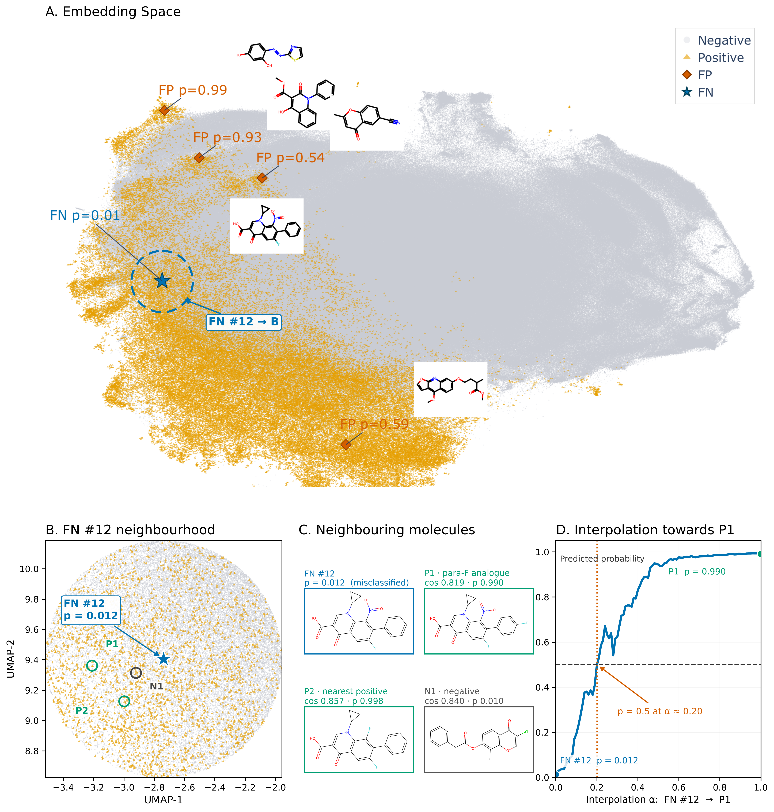

# FN #12 归因分析报告

**分析对象**：外部测试集（april18peak, 4,502 条）中唯一的假阴性样本 #12  
**模型**：CReSS 谱图编码器（`models/2_5_w_model/8.pth`）+ XGBoost 分类器（`output/xgb_cress_new_dataset_ex_train_seed42/model_xgb_cress_new_dataset_seed42.pkl`）  
**日期**：2026-11-08

---

## 1. 样本信息与预测结果

| 项目 | 内容 |
|---|---|
| 测试集序号 | #12 |
| SMILES | `O=C(O)c1cn(C2CC2)c2c([N+](=O)[O-])c(-c3ccccc3)c(F)cc2c1=O` |
| 真值标签 | 1（阳性，含喹诺酮母核） |
| 预测概率 | **p = 0.012**（阈值 0.5，判为阴性） |
| 判定结果 | **FN（假阴性）** |
| 13C NMR 峰 | 175.4, 164.6, 155.6, 153.0, 141.5, 130.6, 130.4, 129.9, 128.8, 128.8, 128.7, 128.6, 128.6, 128.6, 114.3, 108.7, 40.0, 10.5（共 18 个） |

---

## 2. 不是标签错误，也不是阈值问题

1. **标签正确**：该分子是典型的氟喹诺酮，能匹配喹诺酮母核 SMARTS `O=c1cc[nH]c2ccccc12`，`label=[1]` 无误。
2. **不是全局阈值问题**：测试集共 64 个阳性，
   - 其余 63 个阳性的预测概率中位数为 **0.999**；
   - 第二低的阳性概率为 **0.509**；
   - #12 的 **0.012** 是唯一的极端离群点。

因此这是一个**单样本难例**，而不是阈值设置或类别不平衡导致的系统性错误。

---

## 3. 训练集中存在高度相似的阳性类似物

在训练集的 768 维 CReSS embedding 空间中检索 #12 的最近邻，可找到多个结构高度相似的**训练阳性**，但模型对它们都给出 0.98–0.998 的高置信度：

| 训练集索引 | 结构差异 | embedding cosine | 模型对该类似物的 p |
|---|---|---|---|
| 3263827 | 苯环对位 F | **0.819** | **0.990** |
| 3210578 | 苯环对位 CH₃ | 0.816 | **0.987** |
| 3257602 | 苯环无取代、喹诺酮环多一个 F | **0.857** | **0.998** |

也就是说：#12 与训练阳性 3263827 只差一个“苯环对位 H vs F”，但预测概率从 0.99 掉到 0.012。  
这更像是**模型没有泛化到这个取代基变化**，而不是分子本身不属于阳性。

补充：在 embedding 空间中，
- #12 到最近阳性类似物 P1 的 cosine 为 **0.819**；
- 但到两个阴性邻居 N1（386196）和 N2（2728727）的 cosine 分别为 **0.840** 和 **0.861**，阴性甚至比正例更近；
- top-50 邻居中阳性/阴性 = **8 / 42**，top-200 中为 **21 / 179**。

说明 #12 在表征空间中落在一个**阴性与阳性混杂的边界区域**。

---

## 4. 峰值消融实验（核心证据）

### 4.1 方法

对 #12 的 18 个 13C 峰做“删峰—重新编码—重新预测”实验：

1. 删除指定峰，保留其余峰；
2. 用同一个 CReSS 编码器重新得到 768 维 embedding；
3. 用同一个 XGBoost 模型输出阳性概率。

该实验衡量的是模型对各个谱峰的**敏感度**（sensitivity），不是重新训练。

### 4.2 主要结果

| 操作 | 预测概率 | 判定 |
|---|---|---|
| 原始 18 峰 | **0.012** | 阴性（FN） |
| 删掉 130.4 | **0.311** | 阴性 |
| 删掉 **129.9 + 130.4 + 130.6** | **0.910** | **翻成阳性** ✅ |
| 删掉 129.9 + 130.4 + 130.6 + 128.7 | **0.884** | 阳性 |
| 删掉 175.4（羧酸/羰基区） | **0.000** | 阴性 |

柱状对比见补充图 `reports/fn12_peak_ablation.png`。

### 4.3 解释

- **喹诺酮核心峰是“阳性证据”**：删掉 175.4、164.6、108.7、40.0、10.5 后，p 直接降到 0–0.002，说明模型确实依赖这些峰来判断“含母核”。
- **芳香区三个峰是“阴性证据”**：129.9、130.4、130.6 三个峰把模型强推向阴性；只删这三个峰，p 就从 0.012 升到 **0.910**，直接跨过 0.5。
- 这三处化学位移位于 **128–131 ppm 的芳香碳区**，与未取代苯环/喹诺酮芳环的 CH 信号重叠；#12 的“裸苯基”比对位 F/CH₃ 类似物多出这组峰，模型把这组峰型学成了“阴性芳香分子”的特征。
- 删掉整个 128.5–130.7 区间反而使 p 回到 0.12，说明并非“芳香峰越少越好”，而是这三个特定峰的组合触发了模型的阴性规则；喹诺酮自身在该区域的峰仍然是必要的。

### 4.4 完整 leave-one-peak-out 结果

| 删除的峰 (ppm) | 预测概率 | Δp |
|---|---|---|
| 175.40 | 0.0000 | −0.0122 |
| 108.70 | 0.0001 | −0.0121 |
| 164.60 | 0.0001 | −0.0120 |
| 10.50 | 0.0002 | −0.0120 |
| 40.00 | 0.0017 | −0.0105 |
| 114.30 | 0.0023 | −0.0099 |
| 141.50 | 0.0039 | −0.0082 |
| 128.80（两个峰） | 0.0122 | 0.0000 |
| 128.60（三个峰） | 0.0122 | 0.0000 |
| 155.60 | 0.0166 | +0.0044 |
| 153.00 | 0.0251 | +0.0130 |
| 128.70 | 0.1129 | +0.1007 |
| 130.60 | 0.2044 | +0.1923 |
| 130.40 | 0.3114 | +0.2992 |
| 129.90 | 0.3120 | +0.2998 |

---

## 5. 从全局到局部：FN 处于决策边界

**图 1**：CReSS embedding 空间中的 FN #12。(**A**) 全量训练集（3,298,042 条）与 April-18 测试集（4,502 条）的全局 UMAP，训练阴性为灰色点、训练阳性为橙色三角，4 个 FP 为红色菱形，FN #12 为蓝色星号，虚线圆为 **B** 的局部放大区域；(**B**) 以 #12 为中心、半径 0.78 的局部 UMAP（41,961 个训练点）；(**C**) #12 及其最近邻的分子结构；(**D**) 在 768 维 CReSS embedding 空间中从 #12 向 para-F 类似物 P1 插值时的预测概率。

### 5.1 全局化学空间（图 1A）

- **FP（4 个）** 落在橙色阳性云内部，说明模型在局部阳性区域过判，全局图就能直接解释；
- **FN #12** 落在橙色与灰色交界处，全局图上只能看出“它在边界附近”，无法看出是哪些峰把它推过边界，因此需要 **B–D** 的局部分析。

### 5.2 局部视图与机制（图 1B–D）

**图 1B（局部 UMAP）**：以 #12 为中心、半径 0.78 的局部区域（41,961 个训练点，其中阳性 2,732 个，占 6.5%）。阳性（橙色三角）和阴性（灰色点）在局部交错分布；para-F 类似物 P1（idx 3263827）、最近的阳性 P2（idx 3257602）和负例 N1（idx 386196）都落在 FN 周围 **0.5 个 UMAP 单位**以内。

**图 1C（分子结构对比）**：FN #12 与 P1 只差苯环对位一个 F（embedding cosine 0.819），但 P1 的 p=0.990，#12 只有 0.012；P2 是最近的正例（cosine 0.857，p=0.998）；N1 是与 #12 结构无关的阴性（cosine 0.840），p=0.010。

**图 1D（embedding 路径上的决策边界）**：在 768 维 CReSS embedding 空间中，从 #12 向 para-F 类似物 P1 做线性插值，预测概率在 **α ≈ 0.20** 处穿过 0.5。也就是说，只需朝该类似物方向移动约 20%，模型就会把 #12 判为阳性。

**峰值消融（补充，见 §4）**：原始 18 峰 p=0.012；删掉 129.9 / 130.4 / 130.6 ppm 后 p=0.910，跨过 0.5；删掉 175.4 ppm 后 p=0.000。

**解读**：

- 在局部 UMAP 上，#12 同时与正例、负例相邻，不是深入灰色阴性区域；
- 在真实分类空间（768 维）中，#12 距离 0.5 决策面只有 α≈0.20；
- 峰值消融给出了边界的方向：不是“芳香峰越少越好”，而是 129.9 / 130.4 / 130.6 这三个特定峰把样本推向阴性；只删这三个峰，p 就升到 0.910；
- 因此这是一个典型的**边界样本（boundary case）**，而不是“明显阴性被误判”。FP 可以直接从全局 UMAP 看出（落在橙色阳性云中），FN 则需要局部视图 + embedding 路径分析（以及 §4 的峰值消融）才能解释。

---

## 6. 数据裂分是不是原因？

**结论：不是裂分直接导致的。** 裂分没有删除 #12，也没有删除它的近邻；FN 的根因是训练集缺少“8-NO2 + 7-未取代苯基”这一精确取代组合，以及模型对芳香区峰型的过拟合。

### 6.1 裂分黑名单实际删除 0 条

训练脚本用 validation / test / external / f_split / f_without 的 SMILES 构造黑名单（`train_xgb_cress_new_dataset_seed42.py:238`），但：

| 数据源 | 记录数 | `removed_eval_overlaps` |
|---|---|---|
| `new_dataset/train.lmdb` | 3,196,194 | 0 |
| `new_data_1209.filtered.lmdb` | 77,328（文件内去重后 70,170） | 0 |
| `ex_train_add_label_filtered.evalclean.json` | 24,520 | 0 |

即没有任何训练记录因为裂分被移除。补充：#12 同时出现在 external_test、f_split、f_without 三个评估文件中（后两者是 external 的 48 条子集），但三者都只用于评估，不进入训练。

### 6.2 #12 本来就不在训练源中

对三个训练源做精确 SMILES 和 InChIKey 检索：

| 数据源 | 精确 SMILES 命中 | InChIKey 命中 |
|---|---|---|
| `train.lmdb` | 0 | 0 |
| `1209.filtered.lmdb` | 0 | 0 |
| `ex_train` json | 0 | — |

因此 #12 是“源数据里没有这个化合物”，而不是“被裂分删掉”。

### 6.3 训练集里有它的近邻，且都被正确分类

| 训练索引 | 结构关系 | embedding cosine | 模型 p |
|---|---|---|---|
| 3257602 | 8-F + 7-苯基 | **0.857** | **0.998** |
| 3263827 | 8-NO2 + 7-(对-F-苯基) | 0.819 | **0.990** |
| 3210578 | 8-NO2 + 7-(对-CH3-苯基) | 0.816 | **0.987** |

### 6.4 缺少的是“精确取代组合”，不是整个骨架

- N-环丙基喹诺酮阳性：**24,310** 条；
- 8-NO2 + 6-F + 1-环丙基母核：**122** 条；
- 其中 7-位为芳基：只有 **4** 条，且全部是对位取代苯基（F / CH3 / OCH3 / 二甲基+甲氧基），**没有未取代苯基**。

也就是说，#12 的两个“各差一个取代基”的近邻都在训练集中，但“8-NO2 + 7-未取代苯基”这个组合本身没有出现。

### 6.5 来源偏移存在，但不能单独解释

external 的 64 个阳性全部来自 `0327_csv`（54）和 `excel_core_mol`（10）；这两个 source 不在训练集中（训练 source 为 NMRium / multi / napacd / acd_lotusv9 / pnmrnp2 / NMR BANK / c13_naproc / bmrb / nmrshiftdb 等）。

但同一来源的另外 63 个阳性全部被正确识别（p 中位数 0.999），因此来源偏移本身不足以解释 #12。

### 6.6 embedding 覆盖也不是瓶颈

64 个测试阳性到最近训练阳性的 cosine 中位数为 **0.912**。#12 为 **0.857**，排倒数第 2；但倒数第 1 的 #11（cosine 0.852）p=0.992。说明 #12 并不是“离训练阳性最远”的样本，它失败的原因是峰型落在决策面另一侧，而不是没有近邻。

### 6.7 小结

- 裂分是按**精确 SMILES** 留出，实际删除 0 条；#12 在源数据中本来就不存在。
- 如果把 #12 放回训练集，只会“记住”这一个样本；要修复同类 FN，需要补充该取代组合的阳性样本或做峰位增强。
- 因此，**不能把 FN 归因于数据裂分**；它是局部覆盖不足 + 芳香区峰型过拟合导致的边界错误。

---

## 7. 结论

1. **FN #12 的标签是正确的**，不是数据标注噪声。
2. **不是阈值或类别不平衡问题**：它是 64 个测试阳性中唯一的极端离群点。
3. **直接原因**：模型把 129.9 / 130.4 / 130.6 ppm 三个芳香碳峰当成阴性证据；删除这三个峰后预测概率从 0.012 升到 0.910。
4. **根本原因**：CReSS embedding + XGBoost 对“未取代苯基 vs 对位取代苯基”这一小结构变化没有泛化；训练集中存在 embedding cosine 0.816–0.857 的阳性类似物（p≈0.99），但 #12 仍落在表征空间的阴性一侧。
5. **FN 是边界样本（boundary case）**：局部 UMAP 中它与正例 P1/P2、负例 N1 都相邻；在 768 维 embedding 中，只需朝 para-F 类似物 P1 移动约 20%（α≈0.20）就跨过 0.5 决策面。
6. **不是数据裂分导致的**：黑名单实际删除 0 条，#12 不存在于任何训练源；同来源的另外 63 个阳性全部正确，且最近的训练阳性（cosine 0.857）也被正确分类（见 §6）。
7. **UMAP 图只能直接解释 FP**：FP 落在橙色阳性云中，视觉上容易归因；FN 需要局部放大视图 + 最近邻结构/谱图 + embedding 路径分析，才能说明它为什么在边界上（见 §5）。

---

## 8. 局限性

- 本报告只分析了 **1 个 FN 样本**，结论不能直接推广到其他 FN。
- 删峰消融会构造出**非真实谱图**，得到的是模型敏感度，不是严格的因果证明。
- 129.9 / 130.4 / 130.6 ppm 的具体原子归属需要 HSQC/HMBC 等二维谱确认；本报告只说明它们位于芳香 CH 区。
- 未重新训练模型，因此不能保证“加入类似物”一定能修复该 FN。

---

## 9. 建议

1. **在可视化/审核界面加入峰值级归因**：对每个峰做 occlusion sensitivity，直接显示“哪些峰把预测推向阳性/阴性”，这样 FP 和 FN 都可解释。
2. **补充训练样本**：加入“未取代苯基 + 硝基 + F + N-环丙基”这一组合的氟喹诺酮阳性样本，以及对位取代苯基的对照。
3. **数据增强**：对芳香区峰位做小幅扰动/峰合并增强，降低模型对单一峰型的过拟合。
4. **规则 + 模型混合**：喹诺酮母核是明确的子结构规则，可先用 RDKit 子结构做高置信规则，再用模型处理边界样本。
5. **FN 分析流程**：不要只看全局 UMAP；应同时查看最近邻训练样本的结构、谱图和预测概率。

---

## 10. 复现文件

| 文件 | 说明 |
|---|---|
| `reports/fig_paper_fn12_composite.png` | **正文 Fig 1**：A 全局 UMAP（带 ROI）+ B 局部 UMAP + C 近邻结构 + D embedding 插值（600 dpi，180 mm 宽） |
| `reports/make_paper_figure_fn12.py` | 正文 Fig 1 的绘图脚本 |
| `reports/fig_global_umap.png` | 补充/单图版：全量训练集 + 测试 FP/FN 的全局 UMAP（`embedding_umap_full_preview.png` 的副本） |
| `embedding_umap_full.html` | 全局 UMAP 的交互版（43.9 MB） |
| `reports/fig_fn12_case.png` | 旧版 2×2 FN 图（已被 Fig 1 取代，仅保留备查） |
| `reports/make_fn12_case_figure.py` | 旧版 2×2 FN 图的绘图脚本 |
| `reports/fn12_local_boundary.png` | 备用/补充图：A 局部 UMAP + B 结构 + C 插值（无消融） |
| `reports/make_fn12_local_figure.py` | 备用图的绘图脚本 |
| `reports/fn12_peak_ablation.png` | 补充图：单独的峰值消融柱状图 |
| `reports/fn12_structure.png` | 补充图：单独的 #12 分子结构图（与主图 C 重复） |
| `reports/fn12_peak_ablation.py` | 峰值消融脚本 |
| `reports/fn12_analyze.py` | 最近邻检索与结构对比脚本 |
| `reports/fn12_neighbors200.json` | top-200 邻居的索引、embedding cosine、SMILES、NMR |
| `reports/fn12_peak_ablation.json` | 消融实验原始结果 |
| `reports/fig_xgb_pr_roc.pdf` / `.png` / `.svg` | 补充图 Fig Sx：外部测试集 AUPRC/AUROC 曲线（bootstrap CI；运行点 τ_op = 0.50，TP 63/FP 4/FN 1/F1 0.9618） |
| `reports/make_xgb_pr_roc.py` / `fig_xgb_pr_roc_caption.md` | Fig Sx 脚本与图注文本 |
| `reports/calibrate_and_review.py` / `calibration_review_metrics.json` | R2.4 校准 + 复核规则分析（Fig Sy；validation 拟合 Platt/isotonic、先验修正、review 规则三种结果统计与 bootstrap CI） |
| `reports/fig_calibration_review.pdf` / `.png` + `fig_calibration_review_caption.md` | Fig Sy：可靠性图（log-log）、外部分数分布与复核带、外部复核结果表 |
| `reports/encode_eval_sets.py` / `reports/calib_data/` | R2.4 数据准备：validation / internal / external(april18peak) 的 CReSS embedding、XGBoost 原始概率、最近训练正样本余弦 |
| `reports/mc_dropout_generator.py` / `mc_dropout_generator.json` | R2.4 MC-Dropout：CMGNet 生成器 T=20 随机前向，分子层面变异性与母核命中率 |
| `reports/fig_mc_dropout.pdf` / `.png` + `fig_mc_dropout_caption.md` | Fig Sz：MC-Dropout 变异性图 |
