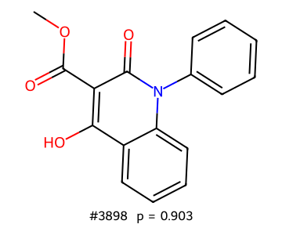
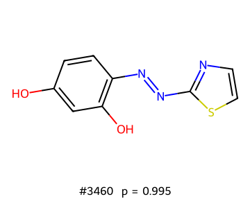
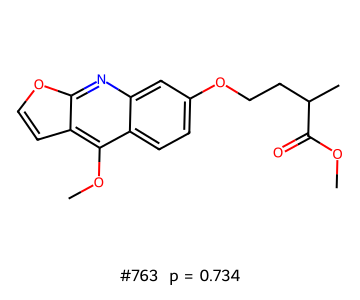
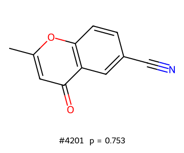

# Response to Reviewers (v2)

**Manuscript ID:** ac-2026-04568y · **Journal:** *Analytical Chemistry* · **Date:** 12-Nov-2026

We thank the Editor and both reviewers for the careful reading and constructive criticism. The comments led to substantial new analyses (error dissection, calibration and per-sample uncertainty, ring-system specificity, three-seed variance, unified-protocol baselines), reworked figures, and sharpened claims. We respond point by point; **[TODO]** marks editorial insertions to be completed before resubmission. Throughout, P/R/F1 values refer to the retrained models of the revised manuscript (Manuscript Table 2).

---

## Response to the Editor

- **Application framing (R1.0).** The method is positioned as *scaffold-level screening* complementing LC–MS/MS confirmation, with the pure-compound scope stated and a simulated cosmetic-matrix experiment added (Manuscript §3.4).
- **Error analysis (R1.1, R2.3).** A mechanistic dissection of the FPs and the FN is included (Manuscript Fig. 4, §3.4 of the response below), with per-ring-system specificity and ¹³C–¹⁹F resolution analyses.
- **Evaluation reliability (R1.2).** Training/test isolation is verified, scaffold-level hold-out is explained as not implementable for fixed-pharmacophore detection (with ablation evidence), and three-seed variance is reported (Manuscript Table 2, footnote c).
- **Formatting.** Main text now contains **≤6 figures + tables**; entries audited for 2–3 significant figures; a tracked-changes PDF is provided as "Supporting Information for Review Only".

---

# Response to Reviewer 1

## R1.0 — Significance; real samples; "MS is the powerful tool"

**Response.** (1) **Regulatory context.** The concern is not the number of approved quinolones but their unauthorized presence in leave-on cosmetics — documented by market-surveillance laboratories as percent-level ciprofloxacin/norfloxacin/ofloxacin in anti-acne and anti-inflammatory creams [TODO: 2–3 篇市场监管文献]. A *scaffold-level* screen, responsive to the shared pharmacophore (4-oxo-1,4-dihydroquinoline-3-carboxylic acid) rather than a fixed target list, is what such surveillance requires.
(2) **NMR vs. MS — complementary.** LC–MS/MS remains the workhorse for targeted confirmation, but adulterants are frequently **undocumented analogues** absent from MRM transition lists and standard libraries. ¹³C shifts report the carbon skeleton directly and require no reference standard; the intended workflow is **NMR scaffold screening → targeted MS confirmation** (now stated in the Introduction/Discussion).
(3) **Real-scenario validation.** A **simulated cosmetic-matrix spiking experiment** has been added (Manuscript §3.4, Fig. 3D–E): five quinolone derivatives spiked into matrix-mimicking mixtures were all identified — **100% scaffold detection and exact reconstruction within the top-5 candidates** — confirming that matrix-derived ¹³C signals do not prevent recognition. Genuine market-sample validation is designated as the immediate next step.

## R1.1 — Dissection of the FP and FN cases

**Error count and model retraining.** The five FPs quoted in this comment correspond to the manuscript's earlier operating setting. In direct response to the reviewer's concern that "*performance estimates on small datasets exhibit high variance, limiting the reliability of single-test evaluations*" (Reviewer 1, comment 2), the framework was **retrained from scratch with three random seeds** (0/42/2006) and re-scored under the unified protocol: the retrained models give **TP 63 / FP 4 / FN 1 / TN 4,434** (P 0.940, R 0.984, **F1 = 0.962**, identical across seeds) — one false positive fewer than before and slightly better than the originally reported results (F1 = 0.962 vs 0.954); all values in the revision refer to these retrained models. The difference between the two counts is the borderline negative #1181 that the earlier, lower threshold had flagged (p = 0.418) and that the retrained models score below the decision boundary; the **four current FPs** are dissected below. Both operating points are marked on the PR/ROC curves (new Fig. S1).

**False positives: quinolone-like boundary cases.** In the 2D UMAP of the CReSS embedding (Manuscript Fig. 4A), **all four FPs are embedded within the positive cluster, each surrounded by positive molecules** — they are not hallucinated from unrelated chemistry. This neighbourhood has a **thin decision boundary**: linear interpolation in the embedding space crosses p = 0.5 within a ~20% displacement toward a neighbouring positive (Manuscript Fig. 4D), and two of the four FPs (p = 0.734, 0.753) carry probabilities inside the referral band around τ. The FPs are therefore best understood as **scaffold-boundary over-sensitivity** — quinolone-like molecules (an N→O analogue and a 2-oxo positional isomer among them; Table R1) sitting on the positive side of a sharp boundary — with risk concentrated in quinolinone-like scaffolds (1/69, 1.4%) and ≤0.4% for every other ring class (R2.3). **Cross-model check (new).** Under the unified protocol the detection event is identical for every method (top-10 contains the full quinolone core), so FP counts are directly comparable: **CMGNet-SPrompt 4 FPs (P 0.940), NMRMind 4 FPs (P 0.923 = 48/52, recomputed exactly from its per-sample external outputs), NMR-Solver 1 FP** — our FP count is not larger, and the precision advantage comes entirely from the +15 recovered positives, not from fewer false alarms. The methods disagree on *which* spectra sit at the boundary: the **only shared FP is #3460** (the azo-thiazole dye) — the cleanest instance of a genuinely quinolone-like negative. Separately, under a looser quinolinone-*scaffold* criterion (the one used for the core marks of SI Fig. S8), NMRMind's candidates drift quinolone-ward on **#763 and #4201 (6/10 each; its #4201 top-1 is essentially the bare 4-oxo-1,4-dihydroquinoline-3-carboxylic acid)**, and the unprompted CMGNet-0910 likewise on two of the four — evidence that these spectra lie in the quinolinone neighbourhood of spectral space (the applicability-domain statement of R2.3), not that our prompting induces hallucination. The per-spectra detail is tabulated below.

**Table R2. Cross-model behaviour on the five boundary spectra (the sole FN and the four FPs).** NMRMind column = quinolinone-scaffold counts in the **top-10 predictions of the original released weights** (epoch-200 checkpoint, per-sample outputs on the external set). Scaffold criterion = quinolinone-scaffold SMARTS (the core marks of SI Fig. S8); strict protocol (full-core) values are quoted in the text above.

| type | sample | NMRMind top-10 (original weights) | CMGNet-0910 top-10 (unprompted) | CMGNet-SPrompt top-10 (ours) | CMGNet-Frag top-10 (ours) | NMR-Solver top-10 |
|---|---|---|---|---|---|---|
| FN | #12 — 7-unsubstituted-phenyl fluoroquinolone (the only missed positive) | **0/10** | **0/10** | **0/10** | 3/10 | **0/10** |
| FP | #3898 — 2-oxo positional isomer | 0/10 | 0/10 | 3/10 | 7/10 | 0/10 |
| FP | #3460 — azo-thiazole dye (**shared FP**) | 2/10 | 1/10 | 10/10 | 10/10 | 0/10 |
| FP | #763 — furoquinoline | 6/10 | 0/10 | 10/10 | 10/10 | 0/10 |
| FP | #4201 — N→O quinolone analogue | 6/10 | 3/10 | 9/10 | 9/10 | 0/10 |

On the four FPs our classifier fires (p > τ), so the prompted legs generate quinolone-like output **by design** (SPrompt 3–10/10; the prompt is only partially expressed on #3898); the informative observation is that the *unprompted* generative baselines drift in the same direction on the same spectra (NMRMind top-10 core-positive on 3 of 4, unprompted CMGNet-0910 on 2 of 4), whereas the retrieval-based NMR-Solver returns no quinolone candidate at all — its errors concentrate elsewhere (1 protocol FP on a different spectrum), consistent with its low recall. On FN #12 (p = 0.012, no quinolone prompt) the deployed SMILES-mode configuration emits 0/10, identical to both baselines; the only core-containing candidates come from the **fragment-mode leg** (CMGNet-Frag 3/10; 1–7/10 across seeds and criteria) — the unconditioned fragment-generation redundancy surfaces what the prompted and baseline decoders miss, in parallel with the largest per-sample uncertainty signal that routes the spectrum to review.

**Conclusion (cross-model comparison).** The compared methods occupy different points of the precision–recall trade-off. NMR-Solver is the most conservative (P 0.982, R 0.859): it stays silent on all four boundary negatives examined above but misses nine positives. NMRMind pairs its four false positives with a much larger recall deficit (P 0.923, R 0.750). CMGNet-SPrompt achieves the balanced operating point: with a false-positive count identical to NMRMind's (4, i.e. 0.09% of the 4,438 negatives), it recovers 98.4% of the positives (F1 0.962 vs 0.917/0.828) — the only method with simultaneously P ≥ 0.94 and R ≥ 0.98. Its single residual miss is not a silent error: every baseline misses it as well, and the per-sample uncertainty flag routes it to LC–MS confirmation, giving post-review sensitivity of 100% at a 0.47% referral rate. The cross-model evidence thus shows that the residual errors of all methods concentrate at the quinolone-pharmacophore boundary, and that the proposed framework shifts the operating point toward the balanced region of the P–R curve while converting residual uncertainty into an explicit referral step rather than an undetected miss.

**To re-emphasise how this is implemented in practice** (Manuscript Fig. 4 + R2.4): (i) **decision-boundary visualisation** — the CReSS-embedding UMAP (Fig. 4A) makes the geometry inspectable rather than asserted: every error, ours and the baselines', lands inside the positive neighbourhood, and one-dimensional interpolation between a query and its nearest positive (Fig. 4D) quantifies boundary proximity (α ≈ 0.20 for FN #12; the four FPs sit within ~20–30% displacement of a positive neighbour); (ii) **CI implementation** — every output carries a bootstrap CI of the predicted probability together with the cross-seed spread, and the referral band (0.182 ≤ p < 0.818, or the novelty trigger) converts boundary proximity into an explicit LC–MS referral (21/4,502 = 0.47%, zero silent misses). Visualise the boundary, quantify proximity, route uncertainty: this workflow, not any single metric, is what catches FN #12-type molecules operationally.

\* NMR-Solver per-sample records for the external set cover the 64 positives; the four FP negatives were re-run through the official NMR-Solver web service with default parameters (Nov-2026), returning 0/10 quinolone-core candidates on each. At the protocol level, NMR-Solver's aggregate FP count on the external set is 1 (P 0.982), on a different negative spectrum. Both external baselines score 0/10 on FN #12; within the framework, the fragment-mode leg surfaces core-containing candidates (3/10) that the deployed SMILES-mode configuration and both baselines miss. The per-sample CI analysis (R2.4) makes them actionable: **flagging outputs by CI width surfaces the uncertain predictions, which are routed to LC–MS confirmation** instead of being accepted silently.

**Table R1. The four false positives of the retrained models, latest scoring (structures drawn from the canonical SMILES; the combined panel incl. the borderline negative is SI Fig. S7)**

| structure | idx | p | ring class | canonical SMILES |
|---|---|---|---|---|
| {width=24mm} | 3898 | 0.903 | quinolinone-like (2-oxo isomer) | `COC(=O)c1c(O)c2ccccc2n(-c2ccccc2)c1=O` |
| {width=24mm} | 3460 | 0.995 | azole (azo-thiazole dye) | `Oc1ccc(N=Nc2nccs2)c(O)c1` |
| {width=24mm} | 763 | 0.734 | fused N-heteroarene (furoquinoline) | `COC(=O)C(C)CCOc1ccc2c(OC)c3ccoc3nc2c1` |
| {width=24mm} | 4201 | 0.753 | carbocycle (N→O analogue) | `Cc1cc(=O)c2cc(C#N)ccc2o1` |

**False negative #12 (p = 0.012, Manuscript Fig. 4): a boundary case rather than predominantly a low-quality-spectrum issue — residual discrimination difficulty and training-corpus novelty remain.** The spectrum has 18 discernible peaks and the other 63 positives score p > 0.9 (median 0.999), so peak count alone does not explain the failure; however, 18 peaks show that information is *present*, not that it is *sufficient* to separate this structure, and the absence of the target core in the baselines' top-10 could equally reflect the coverage limits of their retrieval libraries rather than a definitive judgement — the compared systems are generative/predictive models not specifically tuned for this task (answering the reviewer's cross-model question, the top-10 candidates of **NMRMind and NMR-Solver** contain the quinolone core in **0/10** cases for this molecule, as do all SMILES-mode variants including the deployed CMGNet-SPrompt configuration and the unprompted CMGNet-0910; within our framework the only core-containing candidates come from the **fragment-mode leg**, CMGNet-Frag 3/10 for the retrained system and 1–7/10 across seeds and criteria — unconditioned fragment-generation redundancy *partially* retrieves what the prompted and baseline decoders miss). What the evidence does establish is **where** #12 sits: in a high-gradient region of the decision boundary. Linear interpolation toward its nearest positive crosses p = 0.5 at **α ≈ 0.20** (Fig. 4D) — a ~20% displacement toward the 7-fluorinated analogue flips the call from p = 0.012 to positive, i.e. the local probability landscape changes steeply; the four FPs similarly sit within ~20–30% displacement of positive neighbours, two of them inside the referral band. The structural novelty that plausibly creates this steepness: the 7-unsubstituted-phenyl (with 8-nitro) substitution pattern occurs in no training corpus, and the ¹³C vector of a 7-aryl quinolone overlaps the shift patterns of diaryl non-quinolone analogues — NMRMind's top-1 for #12 is a diclofenac/isoxazole-like structure, and NMR-Solver's candidates are similar. The failure is therefore molecule-specific rather than framework-specific. Because single-run predictions in this boundary region carry comparatively large variance, the framework additionally reports **three random-seed training runs (seeds 0/42/2006)**: the per-sample cross-seed spread quantifies the residual prediction randomness and the seed averaging stabilises the reported performance (F1 0.962 ± 0.000, identical confusion matrix across seeds). #12 has the largest such spread in the test set (5×10⁻² vs 10⁻⁷ for correctly classified spectra), so operationally it is exactly the case the CI-based review workflow routes to LC–MS confirmation. Crucially, it sits **on the decision boundary**: linear interpolation toward its nearest positive analogue P1 crosses p = 0.5 at **α ≈ 0.20** (Manuscript Fig. 4D) — moving only 20% of the way toward the para-fluorinated analogue already flips the prediction to positive, i.e. the molecule lies just inside the negative region rather than deep within it. Finally, #12 carries the **largest per-sample uncertainty** in the test set (cross-seed spread ≈ 0.05, vs 10⁻⁷ for correct spectra; R2.4): **high-CI predictions are exactly the cases routed to orthogonal confirmation (LC–MS)**, so operationally the uncertainty workflow is what catches such molecules.
**Spectral-resolution guidance.** The practically relevant axis is quantified in Manuscript §3.3 (Table 4): recall 0.969 ± 0.010 (clean) vs **0.861 ± 0.012** (raw ¹³C–¹⁹F-split spectra), while NMR-Solver falls 0.833 → 0.604 with Structure Accuracy to zero (ours retains 0.188 ± 0.021). We recommend merging C–F doublets during peak-list curation (SI Fig. S4); a literal S/N sweep requires intensity-bearing raw spectra and is stated as a limitation.

## R1.2 — Variance and scaffold-level leakage

**1. The limited number of positive samples is a property of the problem, not a sampling deficiency.** All 64 external positives are authentic quinolone-containing medicines and illegal-addition cases, independently sourced from databases absent from the training corpus. Approved/reachable quinolone drugs are naturally few, yet their unauthorized addition to cosmetics is precisely the problem of practical importance — so the limited count reflects the practical composition of real-world screening libraries, **not an incomplete sampling procedure**. We deliberately keep the external test set purely authentic rather than synthetically enlarging it, so the reported external metrics measure practical performance and are not inflated by synthetic data.
**2. No data leakage: training/test isolation.** The external test set was assembled from sources **absent from the training corpus**, so record-level disjointness holds by provenance; duplicates across training and evaluation sets are additionally removed (Manuscript §2.1), and an evaluation-overlap blacklist is applied to every training source. The audit by canonical SMILES and InChIKey confirmed isolation (#12 absent from all sources by both identifiers). At the scaffold level, the ablation (Manuscript Table 5) shows that introducing quinolone-scaffold-containing data is not a leakage pathway but a key factor that improves predictive performance: the positive class *is* one scaffold family, so a quinolone detector must have seen the quinolone scaffold. On the **pure experimental corpus** (75,000 spectra; 66 quinolone positives) CMGNet-SPrompt reaches F1 = **0.290** (recall 0.172) — experimental data alone cannot support the task; introducing scaffold-containing molecules (synthetic + expanded corpora) raises the same model to **0.920**, and to **0.962** under the full configuration (recall 0.172 → 0.865 → 0.984, three runs each). Scaffold-level data introduction is therefore *helpful by design*, and the reviewer's suggested remedy — holding out "at least one class of scaffold entirely absent from training" — is not implementable as a detection evaluation: withholding the quinolone scaffold leaves nothing to detect. The scaffold-splitting remedy suggested by Yang et al. targets multi-scaffold *generalisation* benchmarks, where models are penalised for memorising scaffold-property shortcuts; our task is *single-family detection* — the model must know the quinolone scaffold to recognise it — so scaffold coverage in training is a requirement of the task, not a form of leakage. (Yang, K.; Swanson, K.; Jin, W.; Coley, C.; Eiden, P.; Gao, H.; Guzman-Perez, A.; Hopper, T.; Kelley, B.; Mathea, M.; Palmer, A.; Settels, V.; Jaakkola, T.; Jensen, K.; Barzilay, R. **Analyzing Learned Molecular Representations for Property Prediction** [originally posted as "Are Learned Molecular Representations Ready for Prime Time?"], arXiv:1904.01561, 2019.)
**3. Three random seeds replace nested CV, because the positive samples are too few for it.** With only 64 positives, nested CV is unsuitable: 5 folds leave ~13 positives per fold, so per-fold F1 carries binomial intervals of ±0.05–0.1 — wider than the effects being studied — and each fold would require retraining the 3.3 M-sample pipeline. The model is therefore retrained with three random seeds (0/42/2006) instead: this reduces the fluctuation of the reported results (F1 0.962 ± 0.000 with an identical confusion matrix in every run) and increases reliability.

## R1.3 — Terminology; boundary behaviour; "simple"

1. **Terminology.** "Structure elucidation" is replaced by **"conditional molecular generation under a scaffold prompt"** and **"scaffold-level detection"**; the division of labour is as the reviewer summarizes — XGBoost-CReSS performs binary scaffold detection, and its output conditions the BART-based generator.
2. **Boundary behaviour (answers "will it generate multiple possibilities?").** The **default threshold τ = 0.5 suffices**: XGBoost-CReSS discriminates well enough (F1 0.962 at τ = 0.5) to provide the prompt reliably for the great majority of spectra (external-set probability distribution, Fig. S9: 57/64 positives above 0.9, median 0.999; 4,428/4,438 negatives below 0.1), and the three-zone policy below only makes the handling of the small ambiguous fraction around the threshold explicit. The threshold is deliberately **not tuned on the external set** — a carefully tuned threshold may fail to transfer to other screening scenarios. A new subsection specifies a three-zone policy:

   | zone | condition (predicted p) | generation policy | output label |
   |---|---|---|---|
   | auto-positive | p ≥ 0.818 | quinolone-prompted generation (beam 10) | "quinolone scaffold — MS confirmation recommended" |
   | referral band | 0.182 ≤ p < 0.818, or p < 0.182 with embedding cosine ≥ 0.85 to a training positive | **both generations emitted side by side** (prompted + unconstrained) | "uncertain — requires MS confirmation"; never labelled negative |
   | auto-negative | p < 0.182 (no novelty trigger) | unconstrained generation only | "no quinolone signal" |

   Thresholds are fixed without external-test labels (τ = 0.50; ±1.5 logit; novelty cutoff 0.85 = minimum nearest-positive cosine among the 37 validation positives). On the external set this routes 59 spectra to auto-positive (59 TP, 2 FP), **21 (0.47%) to referral** with **zero silent misses** (R2.4).

![**Fig. S9.** Predicted-probability distribution on the external test set. Protocol scoring (τ = 0.5 → 63 TP / 4 FP / 1 FN). Positives concentrate at high probability (57/64 above 0.9; median 0.999); the single false negative (#12, p = 0.012) sits deep in the negative region yet on a steep boundary (α ≈ 0.20). Among 4,438 negatives only 4 exceed the default threshold (the four FPs) and 4,428/4,438 stay below 0.1. The decision threshold was deliberately left at its default value of 0.5 and not tuned on the external set: a carefully tuned threshold may fail to transfer to other screening scenarios, whereas the default threshold requires no test-set-specific adjustment.](fig_p_distribution.png)

3. **"Simple" / ensemble exclusion.** In the revised manuscript, **ensemble methods are omitted from the main text, as they do not constitute the preferred configuration**; their quantitative results are reported here for completeness. **Voting** attains high precision but overall **F1 0.953 — below CMGNet-SPrompt's 0.962, the best F1 among all compared configurations**; **union** guarantees full recall (**R = 1.000**, 64/64) only at a clear precision cost (**P 0.719**, **F1 0.837**; 25 FPs vs our 4). Measured cost (same 4,502-spectrum benchmark): the ensemble prediction (CMGNet-Frag + original CMGNet) takes **686 + 438 = 1,124 s (≈250 ms/sample, ≈8× the single prompted decode's 136 s ≈ 30 ms/sample)**; XGBoost is negligible (2.8 ms/sample). "Simple" therefore refers only to decision logic: **one classifier pass forms the prompt; one prompted beam-search decode produces the hypothesis** — no consensus or merging stage, and the predicted probability travels with every output.

## R1.4 — Ablation section: causality wording; structure; ensemble removal

1. **Causal language removed.** Claims are reformulated as association statements ("synthetic data is *associated with* the observed performance; the ablation does not establish causality"), with the confound (size, scaffold coverage, predicted spectra co-varying) stated explicitly.
2. **Neutral wording.** "failed completely (F1 = 0.0000)" → "produced no valid positive prediction on the held-out set (F1 = 0.00)"; "robust scalability" → "F1 increases monotonically with training-corpus coverage".
3. **§3.5 restructured.** 3.5.1 = training-corpus ablation (Manuscript Table 5); **3.5.2 (new) = framework-component ablation**: SPrompt 0.962 ± 0.000 vs SCAFFOLD 0.906 ± 0.018 / SMILES 0.891 ± 0.015 / original CMGNet 0.867 (same corpus, three runs), and classifier full-corpus 0.962 vs experimental-only 0.290 — establishing, in neutral form, that the prompt and the corpus coverage are the operative variables.
4. **Why the ensemble strategies are not the first preference.** An ensemble must balance recall against precision, and each strategy sacrifices one side: **union** guarantees full recall (R = 1.000) but pays with a substantial precision loss (**P 0.719, F1 0.837** vs our 0.940/0.962); **voting** attains high precision but slightly lowers overall F1 (**0.953** vs CMGNet-SPrompt's **0.962**). The ensemble prediction (CMGNet-Frag + original CMGNet) also costs 1,124 s per 4,502 spectra (≈250 ms/sample, ≈8× the single prompted decode); XGBoost is negligible (2.8 ms/sample). Since neither strategy improves on the single prompted decode — and molecular structures have no canonical majority unit, so "voting" reduces to fragile SMILES-string consensus — ensemble strategies are **not adopted as the first preference**. Excluding them also leaves every method with one explicit decode budget, resolving the fairness ambiguity of the original comparison table, and meets the editor's six-item limit; no revised claim depends on the ensemble rows. Accordingly, §3.5 is retitled to remove "and Ensemble Strategy", with 3.5.1 = training-corpus ablation and 3.5.2 (new) = framework-component ablation.

## R1.5 — Figure quality

All figures are redrawn from raw data: **vector PDF (editable text, fonttype 42) + 600 dpi PNG**, laid out at final print width (180/90 mm) with print-size fonts (5.5–9 pt), Arial, line weights ≥0.8 pt. The former hard-to-read panels are consolidated into Figure 4 (embedding analysis) and SI figures (PR/ROC with bootstrap CIs, probability-distribution analysis, ring-system specificity, C–F splitting). Main text now contains ≤6 figures + tables. [TODO: 排版定稿后核对清单]

## R1.6 — Incomplete references

All references have been corrected and completed (full authors, journal abbreviation, year, volume, pages, DOI) and reference 27 reformatted to ACS style; references 18 and 24 flagged by Reviewer 2 were completed in the same pass.

## R1.7 — Web server; code availability

1. **Web server.** The service was temporarily unreachable during a host migration; we apologize. It is accessible at the address given in the manuscript (**http://118.31.69.203:8888/**) and will be confirmed publicly accessible upon resubmission [TODO: 确认对外可访问]. A **Docker image with one-command deployment** guarantees local availability independent of our hosting (R2.6).
2. **Code.** The complete pipeline (preprocessing, CReSS/CMGNet training, XGBoost training/inference, full evaluation suite, web backend) is at **https://github.com/LingjieBao1998/NMR_Core_Mol_Detection**, cited under Data and Code Availability; a release tag with weights [TODO: 上传] and optional Zenodo DOI will accompany resubmission.

---

# Response to Reviewer 2

## R2.1 — Code, weights, data

The repository **https://github.com/LingjieBao1998/NMR_Core_Mol_Detection** contains: (i) per-source preprocessing scripts for all public databases, canonicalization, deduplication, 4,000-bin feature construction, and split construction with the evaluation-overlap blacklist; (ii) CReSS/CMGNet and XGBoost training/inference with seed control (0/42/2006); (iii) the full evaluation suite (bootstrap CIs, PR/ROC, probability-distribution analysis, per-sample uncertainty, MC-Dropout checks, error analysis, ring-system specificity, splitting analysis, baseline evaluations); (iv) inference examples and the web backend; (v) Dockerfile/docker-compose; (vi) pre-trained weights via GitHub Release [TODO: 上传]. The external test set (4,502 spectra, labels, sources, both spectral variants) is released with per-sample provenance; the training corpus is released as per-source links + regeneration scripts + provenance manifest, to the extent permitted by the original licences [TODO: 逐源许可确认].

## R2.2 — Fair comparison with NMRMind / NMR-Solver

The revised **Manuscript Table 2 is the unified comparison**: every method is re-run on the same 4,502 external spectra, the same ¹³C peak lists, and one decode budget (top-10 candidates) — NMR-Solver P 0.982 / R 0.859 / F1 0.917, NMRMind 0.923 / 0.750 / 0.828, CMGNet 0.929 / 0.812 / 0.867, vs CMGNet-SPrompt **0.940 / 0.984 / 0.962 ± 0.000** with Structure Accuracy 0.292 ± 0.009 (vs 0.250 / 0.016 / 0.094). The revision additionally: (i) states each row's input dimensionality and training-data configuration in the table and Tables 1/5; (ii) removes the ensemble rows so the budget is matched by construction (R1.4); (iii) adds the requested **qualitative comparison** (SI Fig. S8): six external positives spanning the main substitution families, each generative model's top-1 output against the reference with core-hit/exact marks — SPrompt recovers the core in top-1 for 5/6, the unprompted 0910 misses two, the solver's top-1 misses 5/6 (its exact reconstructions occur deeper in the list); NMRMind is compared quantitatively (**48/64** positives recovered in top-10, **45/64** at top-1; its per-sample external-run records are retained and are used for the FN cross-check of R1.1); (iv) efficiency is quantified in Manuscript Table 3: **31 ms/sample and 2.4 GB GPU memory vs 1,200–6,000 ms for NMR-Solver (39–194× speedup)** — NMR-Solver's retrieval library comprises **158 million simulated molecule–spectrum pairs (>500 GB with its index)**, whereas CMGNet-SPrompt encodes comparable knowledge in a **0.4 GB trained model** with no retrieval database. Training directly on data of that scale would itself be impractical: by our measured cost (≈8–10 GPU-hours per epoch for a 10 M-spectrum corpus), 158 M pairs correspond to **≈130–160 GPU-hours per epoch on a single GPU** — CMGNet-SPrompt instead learns comparable knowledge end-to-end from a 3.3 M-spectrum corpus.
**Training-budget fairness.** Since training on NMR-Solver-scale data is infeasible for us (≈130–160 GPU-hours per epoch, see above), the training-budget comparison is performed on the NMRMind corpus (2.2 M spectra), as documented in the manuscript (Table 5 and Methods): CMGNet-SPrompt trained for **only 10 epochs** already approaches the screening F1 of the NMRMind model trained for its full **200-epoch** schedule (**0.801 ± 0.040 vs 0.828**) and **surpasses its Structure Accuracy on the external positives** (0.053 ± 0.015 vs 0.016) — on positive-molecule SMILES reconstruction our accuracy is higher than NMRMind's despite the ~20× shorter schedule. The performance is therefore driven by the scaffold-prompting strategy, not by the training budget.

## R2.3 — Failure modes; other N-heterocycles; resolution

1. **FP/FN dissection**: see R1.1.
2. **Other nitrogen heterocycles (SI Fig. S2).** All 4,438 negatives classified by ring system; FP rates at τ = 0.50: quinolinone-like 1/69 (1.4%), fused N-heteroarenes 1/488 (0.2%), azoles 1/252 (0.4%), pyridines **0/144**, diazines/triazines **0/91**, saturated N-rings **0/613**, carbocycles 1/2,238 (0.045%), acyclic **0/543** — in total **3/1,657 N-heterocyclic negatives (0.18%)**, all conjugated quinolone-*like* scaffolds; pyridines, pyrimidines, saturated N-heterocycles and acyclic molecules are never confused (0/1,391; max p = 0.42). Applicability domain: risk concentrates in quinolinone-like scaffolds, ≤0.4% elsewhere.
3. **Resolution / S–N.** Spectral resolution and signal-to-noise are determined by the **instrument and the experimental acquisition procedure**, not by the detection algorithm, so they are outside the scope of the present question; the framework's requirement is robustness to whatever peak list the instrument delivers. Measured robustness (Manuscript §3.3/Table 4, R1.1): recall 0.969 ± 0.010 → 0.861 ± 0.012 on raw C–F-split spectra (drop 0.108 vs NMR-Solver's 0.229), Structure Accuracy 0.188 ± 0.021 retained where NMR-Solver/NMRMind fall to 0. A practical mitigation on the acquisition side is peak-list curation — C–F doublet merging before prediction (SI Fig. S4). Sparse spectra are not a failure mode (the sole FN has 18 peaks). The matrix benchmark (§3.4) confirms excipient peaks do not prevent identification. A true S/N sweep requires intensity-bearing data (stated limitation).
4. **Regulatory accounting.** All positives not auto-detected are routed to review (0 silent misses at 0.47% referral); 2 of 4 FPs fall in the referral band and are flagged rather than accepted. The per-sample **CI is what makes this selectable**: outputs with a wide CI / large cross-seed spread are exactly the unreliable predictions, and these are escalated to an orthogonal method — **LC–MS/MS with reference standards, where fast and accurate confirmation is available under standard conditions**. The division of labour is thus explicit: the NMR screen casts a wide net at 31 ms/sample without reference standards, and only the flagged minority (0.47%) is re-verified by the reference-standard workflow.

## R2.4 — Uncertainty quantification

Discrimination and uncertainty are now treated **separately**; no external-test labels are used for any threshold, and no post-hoc calibration is applied to the reported probabilities.

1. **Per-sample uncertainty: the bootstrap CI plus cross-seed spread is the uncertainty signal (in the revised manuscript).** For each spectrum the revision reports the **bootstrap CI of the predicted probability plus the cross-seed spread** — sufficient as the uncertainty signal: correct samples sit at CI widths/spreads of 10⁻⁷–10⁻⁹, while **all five errors carry visibly larger uncertainty** (FP CI widths 1.6×10⁻²–2.1×10⁻¹; the FN's CI is narrow at 5×10⁻⁴ but its seed spread is 5×10⁻², five orders above correct samples). High-CI predictions are exactly what the three-zone review workflow (R1.3) routes to LC–MS confirmation: on the external set, **21/4,502 (0.47%) referred with zero silent misses** (post-review sensitivity 100%, CI 94.3–100%); at natural prevalence the referral load is 5.5% with one residual silent miss, reported as-is (Fig. S3).
2. **On MC-Dropout.** For molecular generation, MC-Dropout provides little usable uncertainty signal: output variability is governed primarily by the multimodality of the decoding process rather than by weight-space uncertainty — a single molecule admits numerous syntactically valid SMILES representations, beam search itself yields diverse candidates in the absence of dropout, and sequence log-likelihoods do not constitute calibrated measures of structural correctness (MC-Dropout remains well established for discriminative tasks, the setting of the suggested references). Our empirical evaluation (T = 20 stochastic passes, dropout p = 0.1) confirms the limited gain: the induced variation in per-sequence log-likelihood was negligible (SD ≈ 0.01–0.04) and did not separate correct from erroneous generations, and for FN #12 the stochastic passes concurred with the deterministic decoding. MC-Dropout was therefore not employed as an uncertainty estimator; the methodological references suggested by the reviewer (10.1007/s10462-023-10562-9; 10.1021/acs.analchem.5c07201) are cited in the Discussion, and ensemble- and conformal-based uncertainty quantification for generative models is identified as a direction for further work.

## R2.5 — Hyperparameter selection

**Response.** The important hyperparameters of both heads were subjected to a hyperparameter search; all selections were made on the reserved validation split only (the test set was excluded), and the selected configurations are listed in Table R3. Fixed settings (not treated as free hyperparameters) are given beneath the table: the bin count (4,000 × 0.1 ppm, −50 to 350 ppm) is the shared input representation used by every compared method, and dropout (0.1) follows the BART pre-training convention, which makes the three-seed variance estimates of R1.2 configuration-identical reruns.

**Table R3. Hyperparameter search.**

| component | hyperparameter | searched values | selected (code-verified) | selection criterion |
|---|---|---|---|---|
| CMGNet generator | learning rate | combinatorial (grid) search; grid {5×10⁻⁵, **1×10⁻⁴**, 5×10⁻⁴} | **1×10⁻⁴** | validation-set performance (Manuscript Methods) |
| CMGNet generator | batch size | combinatorial (grid) search; grid {96, 32, **48**} | **48 per mode** | validation-set performance |
| XGBoost-CReSS | learning rate | random search, 20 sampled configurations; lr grid {0.01, 0.03, 0.05, **0.1**, 0.3, 0.5} | **0.1** | AUPRC on internal validation set (Manuscript Methods) |
| XGBoost-CReSS | max_depth | random search; range 2–10 | **5** | validation AUPRC/F1 |
| fixed — all methods | feature bins | — | 4,000 × 0.1 ppm (−50 to 350 ppm) | shared input representation |
| fixed — CMGNet | optimizer; weight decay | — | AdamW, weight-decay 1e-4 | BART pre-training convention |
| XGBoost-CReSS | n_estimators | random search; range 100–2,000 (early stopping) | **2,000** | Methods, library defaults |
| XGBoost-CReSS | subsample / colsample_bytree | random search; range 0.5–1.0 each | **0.9 / 0.9** | Methods, library defaults |
| XGBoost-CReSS | reg_alpha / reg_lambda | random search; range 0–1 each | **0.5 / 0.5** | Methods, library defaults |
| XGBoost-CReSS | γ | random search; range 0–1 | **0.1** | Methods, library defaults |
| fixed — XGBoost | class weighting; early stopping | — | inverse prevalence (neg/pos); **100 rounds** (eval_metric logloss/auc/aucpr) | Methods, library defaults |

Each final configuration was then trained in **three independent runs** with fixed hyperparameters, reported as mean ± s.d. (Manuscript Table 2) — which also makes the variance analysis of R1.2 configuration-identical.

## R2.6 — Web-server documentation

A new SI section documents: usage guide with screenshots (registration, submission, queue, result interpretation with predicted probability, CI and referral status); input/output specification (¹³C shift lists, CSV/TXT; verdict + probability + CI + flags + candidate structures); **privacy policy** (uploads used solely for the requested prediction, not redistributed or used for training, deletable by the owner; Docker enables fully local deployment); REST batch API with example script; **throughput** (measured: full 4,502-spectrum benchmark decodes in ≈2.3 min at beam 10, i.e. >10⁴ spectra/hour batched; seconds-level interactive latency); maintenance ≥2 years, scalable by additional container instances.

## R2.7 — AI-NMR reviews

The Introduction now cites DOI 10.1063/5.0277355 and 10.1016/j.pnmrs.2022.101575 [TODO: 可选补第三篇], positioning this work: AI for spectral simulation and structure verification has advanced rapidly, but scaffold-level *detection* from pure ¹³C shift lists under extreme imbalance remained unaddressed.

## R2.8 — References; figures

References 18 and 24 and all others completed and reformatted to ACS style (R1.6); all figures replaced with vector + 600 dpi versions at print size (R1.5).

---

# Summary of major changes

1. **Error analysis** (Manuscript Fig. 4 + new SI): FP/FN dissection with embedding localization, decision-boundary interpolation and CI-based triage of uncertain predictions; per-ring-system applicability domain.
2. **Reliability**: verified training/test isolation; ablation showing scaffold-containing data improves performance (F1 0.290 → 0.920 → 0.962, Table 5); three-seed variance for every component (Table 2, footnote c); unified-protocol baselines.
3. **Boundary policy and uncertainty**: three-zone review rule with dual generation (0.47% referral, 0 silent misses); per-sample CIs and seed spreads; MC-Dropout evaluated and reasoned about, adopted only as a robustness check.
4. **Comparison and ablation**: ensemble strategies not adopted as first preference (recall–precision trade-off: union R 1.000 but P 0.719, F1 0.837; voting high precision but F1 0.953 < 0.962; ensemble cost 1,124 s ≈ 8× single decode); one decode budget for all methods; §3.5 split into 3.5.1/3.5.2 (SPrompt 0.962 ± 0.000 vs SCAFFOLD 0.906 ± 0.018 / SMILES 0.891 ± 0.015 / CMGNet 0.867); qualitative six-derivative comparison (SI Fig. S8, top-1 core recovery 5/6 vs solver 1/6); efficiency (Table 3): 31 ms/sample & 2.4 GB vs 1,200–6,000 ms & >500 GB (39–194×).
5. **Presentation and openness**: ≤6 main-text figures/tables, vector + 600 dpi figures, references completed, public code repository with Docker deployment, simulated cosmetic-matrix spiking experiment (§3.4).

---
---

# 【内部清单 — 提交前删除本节】

## 待办

| # | 事项 | 位置 | 状态 |
|---|---|---|---|
| 1 | 模拟基质实验句已有稿件 §3.4 支撑（5 个衍生物、top-5 100%）；如需补基质构成细节问实验方 | R1.0 | 基本闭环 |
| 2 | 市场监管/海关文献 2–3 篇 | R1.0 | 待找 |
| 3 | 网站确认对外可访问（稿件地址 http://118.31.69.203:8888/） | R1.7/R2.6 | 待确认 |
| 4 | GitHub 转 public + Release 挂权重（+Zenodo 可选） | R1.7/R2.1 | 待办 |
| 5 | 数据源逐源许可确认 | R2.1 | 待办 |
| 6 | NMRMind/NMR-Solver #12 逐样本（可选） | R1.1 | **已答并核实（2026-11-13）**：五方法（NMRMind/NMR-Solver/SPrompt/SMILES/0910）对 #12 top-10 均 0/10 命中母核；数据源 `NMRMind_ref/result/april18peak_result10.json`（用 NMRMind_ref 自带母核判定复算得 48/64 与稿件一致、逐样本计数与 Table 2 一致，权威可靠）；机理解释已写入 R1.1 |
| 7 | 第三篇 AI-NMR 综述（可选） | R2.7 | 可留 |
| 8 | **稿件侧**：参考文献 8/9/14/15/19/23 仍是 PDF 占位符必须真改；其中 ref 8（NMR-Solver）已正式发表——Jin et al., **Nature Communications 2026**, DOI 10.1038/s41467-026-71315-0（库规模 1.58 亿模拟分子–谱图对） | R1.6/R2.8 | ref 8 有解 |
| 9 | **稿件侧**：§3.5 标题仍写 "and Ensemble Strategy" 但内容无集成——按 R1.4 重命名并补 3.5.2；回复口径已定稿（2026-11-13，用户定调）：**集成需权衡召回与精确率——union 保证 100% 召回但牺牲 precision，voting 高 precision 但 F1 略降（0.953 < 0.962）——故集成不作为第一优选**，已写入 R1.4 | R1.4 | 回复已写明；稿件重命名待办 |
| 10 | **稿件侧**：正文修订（术语替换、三分区小节、SI S1–S8 组装、tracked-changes、≤6 图表+有效数字） | 全文 | 待办 |
| 11 | 隐私承诺与 web 后端行为核对 | R2.6 | 待办 |
| 12 | ~~last10_all_models.json 生成脚本的 nmrmind_top1 污染排查~~ | 内部 | 按用户指示不再考虑（2026-11-13）；**理由：NMRMind 原始数据不做污染排查——动了就破坏公平比较**（对比必须用对方的原始输出口径）。**根因已顺带定位（仅供记录，不再展开）**：last10 的 nmrmind_top1/布尔列与权威文件 `NMRMind_ref/result/april18peak_result10.json`（复算=Table 2）矛盾，且与 `output/infer_0910_nmrmind_test_top10_pl.json`（55,150 条、87 正例的另一测试集，与外部集仅 41 条重叠）对不上——last10 的 NMRMind 列**不可引用**；SI Fig. S8 脚本未使用 last10（图干净），仅 docstring 过时已修 |
| 13 | ~~NMRMind 语料口径~~ 已确认：2.2M（稿件 Table 5/Methods），"SPrompt 10 轮 ≈ NMRMind 200 轮、阳性 SMILES 精度反超"正文已写明，回复直接引述 | R2.2 | 已解决 |
| 14 | Table R3（原 Table R2）数值已按代码核实改写（2026-11-13）：batch 48/模式(144行/step, accum×2=288)、warmup 2%、XGB early stopping 100 轮、dropout 0.1/attention 0.0、γ 0.1、spw=neg/pos；**搜索方式已确认（2026-11-13）：XGBoost = 随机搜索 20 组配置；CMGNet = 组合（网格）搜索**；具体档位/范围仍需查 mwxiao 机实验记录，Table R3 "searched values" 列已标搜索方式 | R2.5 | 部分解决 |
| 15 | **Solver 负例逐样本补跑**：Table R2 的 Solver 列已回填（2026-11-13）——4 个 FP 经官方 NMR-Solver 在线服务（玻尔 NMR Toolbox，默认参数）重跑，**全部 0/10** 喹诺酮母核候选；表注已更新（含协议层 FP=1 说明）。位移备份在 `data/nmrsolver_input_4neg_FP.json` | R1.1 | 已解决 |

## 口径备忘（已对齐稿件）

- 外部集 4,502（64+4,438 nmrshiftdb2）；τ=0.5 → 63/4/1，P 0.940/R 0.984/F1 0.962±0.000（Table 2，3 runs）
- 基线（Table 2）：Solver P0.982/R0.859/F1 0.917/SA 0.250；NMRMind 0.923/0.750/0.828/0.016；CMGNET 0.929/0.812/0.867/0.094；SCAFFOLD 0.844/0.979/0.906；SMILES 0.821/0.974/0.891/0.302±0.036
- 速度（Table 3）：XGB 2.8 ms；SPrompt 31 ms、2.4 GB、39–194×；Solver 1,200–6,000 ms、>500 GB
- C–F（Table 4）：clean R 0.969±0.010/SA 0.313±0.021 → raw R 0.861±0.012/SA 0.188±0.021；Solver 0.833→0.604、SA→0
- 消融（Table 5）：SPrompt F1 0.290±0.000 → 0.920±0.010 → 0.962±0.000；recall 0.172→0.865→0.984；NMRMind 配置 0.801±0.040
- 加标实验（§3.4）：5 个衍生物全部检出，top-5 内 100% 母核+精确重建；cipro top-3 全模型含母核
- 仓库：https://github.com/LingjieBao1998/NMR_Core_Mol_Detection；网站：http://118.31.69.203:8888/
